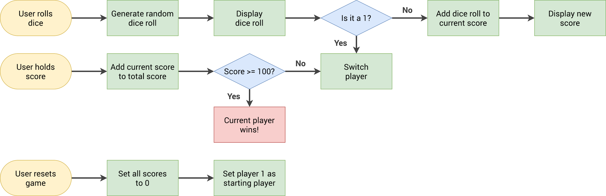

# Pig Dice Game


[try it now !!](https://abo-ah-md.github.io/interactive-Dice-Match/)

A simple and interactive implementation of the classic "Pig Dice Game" using **HTML**, **CSS**, and **JavaScript**.

## Overview

The Pig Dice Game is a fun two-player dice game. Players take turns to roll a dice, accumulate points, and decide whether to keep rolling or hold — but beware: rolling a 1 loses your turn and your accumulated points for that round!  
The first player to reach 100 points wins.



## Features

- **Two-player gameplay**  
- **Score tracking:** current/total scores shown for each player  
- **Visual dice images for each roll (1–6)**  
- **New game/reset functionality**  
- **Active player highlighting**  
- **Intuitive interface with clear rules**

## Gameplay Rules

1. On your turn, roll the dice as many times as you like, adding each roll to your *current* round score.
2. If you roll a `1`, your round score is lost and your turn ends.
3. Use "Hold" to add your current score to your *total* and pass the turn.
4. First player to reach **100** wins the game.

## Technologies Used

- **HTML**
- **CSS**
- **JavaScript**
- Visual assets for dice faces (`dice-1.png`, `dice-2.png`, ... `dice-6.png`)

## How to Run Locally

1. Clone this repository:
    ```
    git clone https://github.com/abo-ah-md/pig-dice-game.git
    ```
2. Open `index.html` in your browser.
3. Start rolling!

## Contributing

Pull requests are welcome!
- Report issues or bugs via [GitHub Issues](../../issues)
- For improvements/features, fork the repo and submit a pull request

## License

This project is released under the MIT License.

---

Enjoy the game and challenge your friends!
